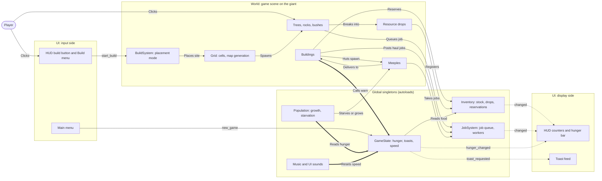
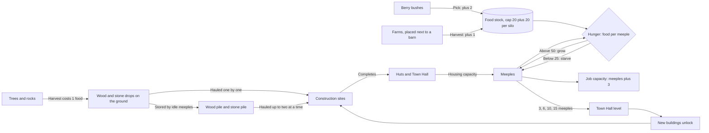
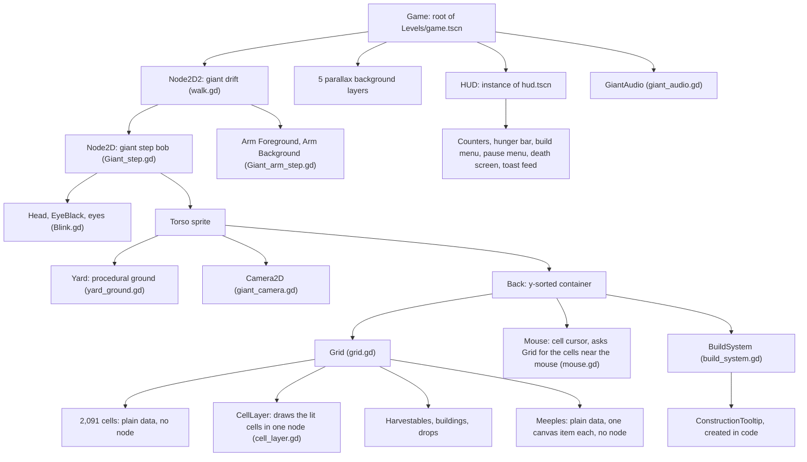
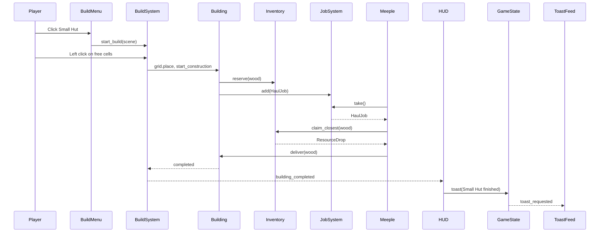
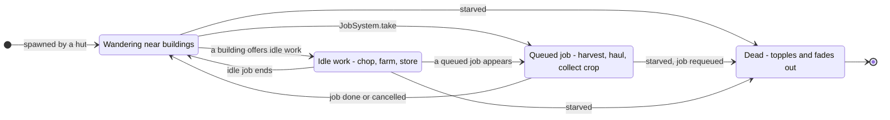
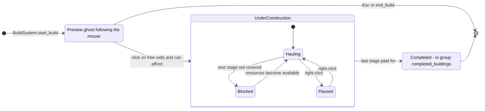
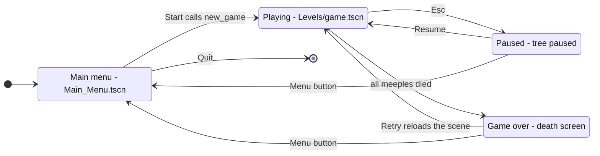
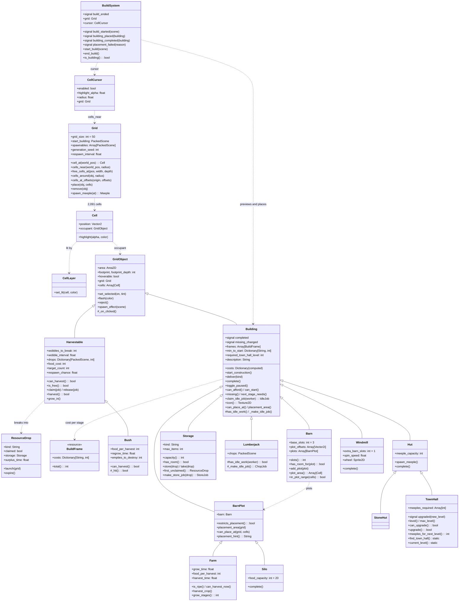
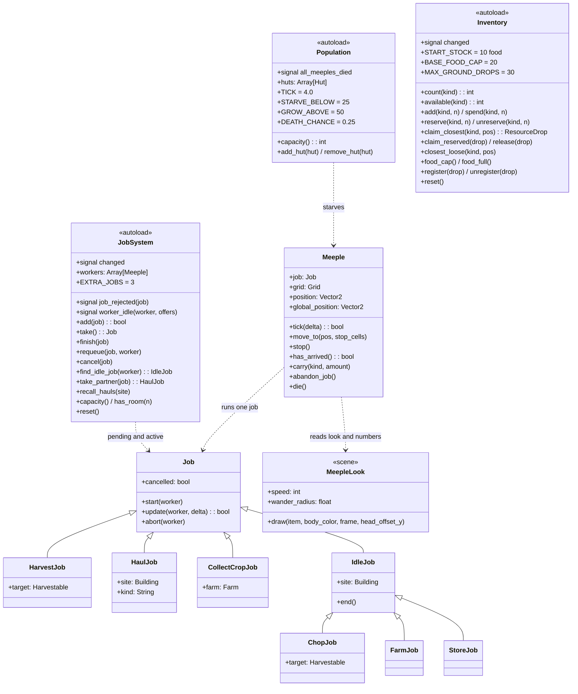

# Architecture (as built)

**What this is:** diagrams of the code as it stands, not a plan. They were drawn from `master` at commit `3c9e6c8` on Nov 9, 2026.

**Keep it true:** when a pull request changes the structure, update the matching diagram in the same pull request. The diagrams are plain text, so the change shows up in the diff.

This file is the source of truth. Older copies of the diagrams exist as Figma boards. They are a snapshot from Nov 9, 2026 and are no longer updated:

- [Architecture board (FigJam)](https://www.figma.com/board/VJ8tnLiibSX9ivptyp2nuX)
- [UML class diagrams (Figma)](https://www.figma.com/design/x7lqHkZwWVC6byvmSV2T8q?node-id=1-2)

## Contents

- [The three layers](#the-three-layers)
- [System map](#system-map)
- [Economy loop](#economy-loop)
- [Scene tree of the game scene](#scene-tree-of-the-game-scene)
- [From click to finished building](#from-click-to-finished-building)
- [Meeple job lifecycle](#meeple-job-lifecycle)
- [Building construction lifecycle](#building-construction-lifecycle)
- [Game flow between screens](#game-flow-between-screens)
- [Class diagrams](#class-diagrams)

## The three layers

| Layer | What is in it | Where |
| --- | --- | --- |
| World scene | The grid, everything on it, meeples, drops, `BuildSystem`. All of it hangs under the giant's torso node | `assets/Scenes/Levels/game.tscn`, `assets/Scripts/` |
| Global singletons | `JobSystem`, `Inventory`, `Population` hold the simulation. `GameState` holds hunger, toasts and speed. `Music`, `VillageAudio`, `DevSpeed` are support | The `[autoload]` section of `project.godot` |
| UI scenes | Main menu and HUD | `Main_Menu.tscn`, `assets/hud.tscn`, scripts at the project root |

The world registers with the singletons, and the singletons tell the UI what changed through signals. Three spots break that direction, and the system map shows them as thick arrows.

## System map

Solid arrows are direct calls. Dotted arrows are signals. Thick arrows are simulation code that depends on `GameState`, the same object that drives the HUD.

## Economy loop

The rules as coded today, with the real numbers.

## Scene tree of the game scene

How `assets/Scenes/Levels/game.tscn` is nested. The whole village sits under the giant's torso, so it rides the walk cycle.

## From click to finished building

The order of calls when the player builds a Small Hut. Solid arrows are calls, dashed arrows are return values and signals.

## Meeple job lifecycle

From `meeple_movement.gd` and `job_system.gd`. A meeple drops idle work the moment any queued job exists.

## Building construction lifecycle

These states have no names in code. They are implied by four flags and two groups in `building.gd`.

## Game flow between screens

## Class diagrams

Three diagrams cover 53 of the 57 scripts. The four left out are tiny: `walk.gd`, `Blink.gd`, `menu_meeple.gd` and `resource_ui.gd`.

How to read them:

- A solid arrow with a triangle means "extends".
- A dotted arrow means "holds or uses".
- `+` is public, `#` is meant to be overridden. Private members are left out.
- `<<autoload>>` is a global singleton, `<<resource>>` is a data resource, `<<unnamed>>` is a script without a `class_name`.
- `<<scene>>` is the root script of a scene that the game reads once as a template (`MeepleLook` is `meeple.tscn`).

### Class diagram 1: world objects

Everything that sits on the grid: the grid itself, harvestables, drops and all building types.

### Class diagram 2: jobs, meeples and the simulation singletons

How work gets done: the job queue, the six job types, the meeple that runs them, and the two singletons that hold the economy and the population.

### Class diagram 3: UI, audio, camera and the giant

The remaining singletons and everything the player sees. The arrow from `UISounds` to `GameState` is a rule hiding inside an audio script: a warning toast resets the game speed.

```mermaid
classDiagram
    direction TB
    class GameState {
        <<autoload>>
        +signal hunger_changed(value)
        +signal starved
        +signal toast_requested(text, kind)
        +signal speed_changed(speed)
        +hunger: float
        +speed: float
        +SPEEDS = 1, 1.5, 2, 3
        +new_game()
        +toast(text, kind)
        +tip(text) / fact(text) / warn(text)
        +cycle_speed()
        +set_speed_index(i)
    }
    class UISounds {
        <<unnamed>>
    }
    class Music {
        <<autoload>>
        +MENU_SCENE, GAME_SCENE: String
        +play_success_riff()
        +fade_out_game_over(seconds)
    }
    class VillageAudio {
        <<autoload>>
        +LIBRARY: axe, pickaxe, grass, hammer, log, hurt
        +VOICE_COUNT = 6
        +play(sound_name, at)
    }
    class DevSpeed {
        <<autoload>>
        +FAST = 3.0
        +KEY = X
    }
    class MainMenu {
        <<unnamed>>
        +start_button, credits_button, quit_button
        +credits_panel, credits_back_button
    }
    class HUD {
        <<unnamed>>
        +build_system: BuildSystem
        +build_menu: BuildMenu
        +pause_menu, death_screen: PauseMenu
        +camera: CameraControls
        +labels, hunger_bar, speed_button
        +OPENING_TIPS, TIPS, FUN_FACTS
    }
    class BuildMenu {
        +BUILDINGS: 11 PackedScenes
        +HOTKEYS: 1 to 0 and minus
        +build_system: BuildSystem
        +open() / close()
        +unlocked_names(level)
        +display_name(scene) static
    }
    class PauseMenu {
        +restart_on_resume: bool
        +resume_button, menu_button, quit_button
        +open() / close()
        +fade_in(seconds, black_seconds)
    }
    class ToastFeed {
        +max_toasts: int = 9
        +lifetime: float = 30
        +push(text, kind)
    }
    class HungerBar {
        <<unnamed>>
        +food_plate, food_label
    }
    class ConstructionTooltip {
        +describe(site) static
        +site_under_mouse(tree) static
    }
    class CameraControls {
        +move_speed, min_zoom, max_zoom
        +zoom_by(factor)
        +zoom_to_mouse(factor)
        +is_zoomed_out(): bool
    }
    class GiantPart {
        +signal lifted(index)
        +signal landed(index)
        +lift_time, hang_time, slam_time
        +settle_time, pause_time
        +lands_on(index): bool
        #_pose(index, t): Vector2
    }
    class GiantAudio {
        <<unnamed>>
        +camera: CameraControls
        +feet: Array[GiantPart]
        +crumble_points: Array[Node2D]
    }
    class YardGround {
        +preset, frequency, preview_seed
        +generate(world_seed, is_ground)
        +band_at(world_pos)  (unused)
    }
    class MenuMeepleSpawner {
        +front_layer: Node2D
        +min_delay, max_delay
    }
    class GiantCamera {
        <<unnamed>>
        +wide_position: Vector2
    }
    class GiantStep {
        <<unnamed>>
        +step_height, sway
    }
    class GiantArmStep {
        <<unnamed>>
        +shift_distance, bob_height
        +starts_shifted: bool
    }
    CameraControls <|-- GiantCamera
    GiantPart <|-- GiantStep
    GiantPart <|-- GiantArmStep
    UISounds ..> GameState : resets speed
    Music ..> UISounds : owns
    MainMenu ..> GameState : new_game
    HUD ..> GameState : toasts, hunger
    HUD ..> BuildMenu : opens
    GiantAudio ..> GiantPart : listens to feet
```

