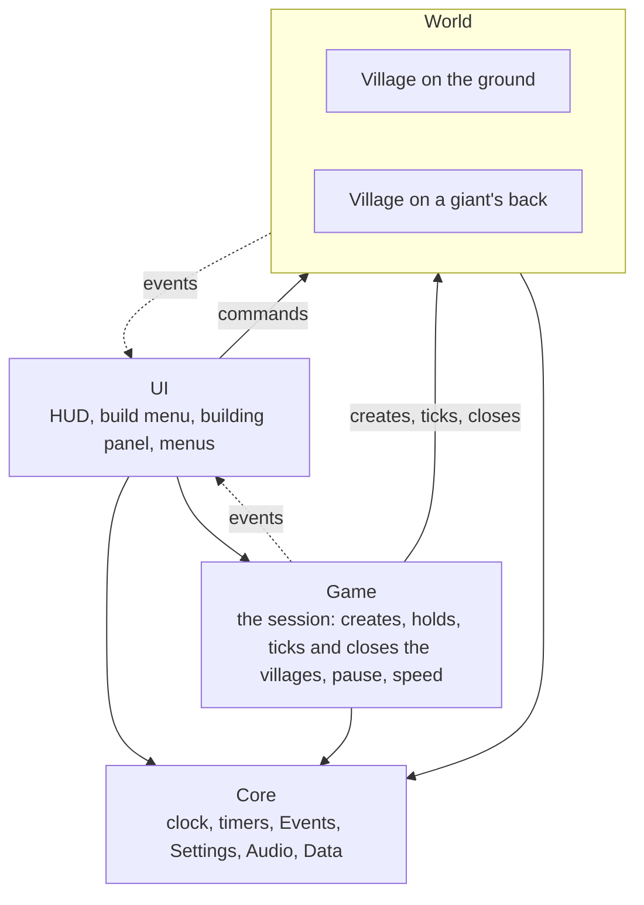
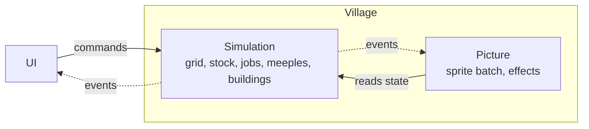

# Core design

**What this is:** the design of the new core of Mighty Meeple, and the numbered list of decisions behind it. The plan that builds it is issue [#57](https://github.com/Liam-M-Mays/game-jam-2026/issues/57).

> An AI agent wrote this page from Liam's decisions of 2026-11-10. Liam agreed to the design in chat. He has not read this page yet.

**Keep it true:** when a pull request changes the design, update this page in the same pull request. A new decision gets the next free number. A number is never reused.

## Contents

- [The short version](#the-short-version)
- [The five rules](#the-five-rules)
- [The layers](#the-layers)
- [Inside one village](#inside-one-village)
- [Time](#time)
- [Meeples](#meeples)
- [Jobs and roles](#jobs-and-roles)
- [Drawing](#drawing)
- [World, grid and walking](#world-grid-and-walking)
- [Stock, drops and buildings](#stock-drops-and-buildings)
- [UI, services and tools](#ui-services-and-tools)
- [Folders](#folders)
- [What is measured and what is not](#what-is-measured-and-what-is-not)
- [Set for now](#set-for-now)
- [Decisions](#decisions)

## The short version

The core gets rewritten so that a village is one self-contained object, and so that meeples, drops and grid cells are plain data drawn in one batch. That is what lets the game hold thousands of meeples, and more than one village later.

- **Proven by the stress test:** 10,000 meeples with 6,000 static things run at about 62 frames per second in GDScript. Today's meeples drop under 60 at about 1,000.
- **Simulation and picture are separate.** A village keeps running in full when it is off screen. Only the drawing is skipped.
- **Jobs find meeples.** A new job grabs the closest free builder. If none is free it waits in a backlog, and a freed builder takes the closest waiting job.
- **Roles work like Manor Lords.** A building has worker slots, and a meeple assigned to it works only there.
- **Rules live in data files.** Adding a building means a data file and a sprite sheet.
- **Not proven yet:** path-finding and real jobs at that scale, and a world bigger than the screen. Each gets its own test before it is built.

**Done means:** the same game as the jam build, on a generated ground world and also on the giant's back, with roles in place of idle jobs, the open fixes, and the small quality of life points from the playtest.

**Not part of the rework:** giants walking by, second villages, a world map, sending materials between villages, animals, roads, new ores, an ending after the statue, baby meeples, seasons, rivers, enemies, a settings menu, lighting, saving. The design leaves room for them. Nothing here builds them.

## The five rules

Everything else on this page follows from these five.

1. **A village is one object.** Its grid, stock, jobs, people and buildings hang under it. Nothing about a village lives in a global. In the jam game `JobSystem`, `Inventory` and `Population` are global, and 151 lines in 25 scripts reach into them.
2. **Simulation and picture are separate.** The simulation is data and rules. It never touches the camera, the mouse, the HUD or a sprite. The picture reads the simulation and draws it.
3. **The many are data, the few are objects.** Meeples, drops, trees, rocks and cells are rows in arrays. Buildings, villages and giants are one object each.
4. **Nothing polls.** Work happens when something changes: a job appears, a meeple arrives, a timer runs out. In the jam game every free meeple asks for work again and again.
5. **Rules come from data files.** Costs, capacity, worker slots and unlock levels are written down. In the jam game pile capacity, farm stages and Town Hall levels are counted from sprite frames.

## The layers

There are four layers, and calls only go down.

- **The UI** talks to Game and to the village in view.
- **Game is the session.** It sits on top of the villages: it creates, holds, ticks and closes them, and it owns pause and speed. See Decision 33.
- **The World** is the villages themselves, on the ground or on a giant's back. A village never names Game.
- **The news of a village comes from the village itself**, never through Events. The UI listens to the village in view, and Game tells it which village that is.
- **The Core** is the bottom layer. It is only what knows nothing about villages: the clock, the timers, Events, Settings, Audio and Data. Everything may use it.
- A lower layer never calls a higher one: it sends an event, and whoever cares listens.

## Inside one village

A village is two halves: a simulation that holds the truth, and a picture that draws it.

Commands go in, events come out, and the picture reads the state. Because the simulation needs no window, a village can tick off screen, and CI can run one in a test.

In the code, simulation files sit in a `sim/` folder and picture files in a `view/` folder inside each feature folder.

## Time

The simulation runs on a fixed tick, and the picture runs as fast as the screen allows.

- **Tick rate:** a set number of steps per second. 20 is the starting value. It is a dev setting.
- **Game speed:** more ticks per second. This replaces changing the engine's time scale.
- **Off screen:** every village ticks, shown or not. A village that is not shown skips drawing and nothing else.
- **Between ticks:** the picture glides each meeple from its last position to its next one.
- **Waiting costs nothing:** a meeple that is waiting or working sets a wake-up tick. Only walking meeples are stepped.

Still to test: letting the shader do the glide, so the processor does no drawing work between ticks.

## Meeples

A meeple is a row number, not a node.

- **One set of arrays per village:** position, target, state, current job, assigned building, what it carries, colour and bounce offset.
- **One system moves them all.** There is no script per meeple.
- **Every meeple walks at the same speed.** Each one starts its bounce at a random point, so a group does not move as one block. That fixes [#46](https://github.com/Liam-M-Mays/game-jam-2026/issues/46) by design.
- **No meeple belongs to a house.** The village tracks the total of meeples and the total room, nothing more.
- Animals can use the same system later, with their own kind and sprites.

Measured: moving 10,000 wandering meeples costs 1.6 ms per frame in GDScript.

## Jobs and roles

A job looks for a meeple. Meeples never search for work.

**Builders** are the meeples with no building. They do what the player clicks, plus hauling and construction.

1. A new job asks for the closest free builder. If one is found, the job starts at once.
2. If none is free, the job goes to the backlog.
3. A builder that becomes free takes the closest waiting job from where it stands, not the oldest.

Example: one builder is busy. The player clicks a far tree, then a near one. The builder does the near tree first.

- There is no limit on waiting jobs, and a job can wait forever for now.
- The player sees the marks on the things, plus a count of the waiting jobs.
- The player can clear every waiting job at once, with a button and a key. Jobs cannot be reordered.
- A job whose target cannot be reached is cancelled with a red flash.

**Workers** are the meeples assigned to a building.

- Each building kind has a set number of worker slots, written in its data file. Every building starts with 1.
- Clicking the building opens a panel. Arrows add or remove a worker.
- The add arrow takes the next available meeple: a free builder now, or the next one that becomes free.
- A worker runs that building's loop and nothing else. A lumberjack's loop is: find the nearest tree in range, walk, chop, repeat.
- A worker stands for a short moment between two tasks. A worker with no work wanders.
- What a worker produces drops on the ground. A drop is picked up only when a building site needs it, or when a worker at a storage building stores it.
- When a worker dies, the slot refills by itself with the next available meeple.
- **Farms:** the barn has the worker slots. Its workers harvest all of that barn's farms. A click on a farm, a silo or the barn opens the barn's panel.
- With no food, everyone keeps working.

**Keeping "closest" cheap:** free builders and waiting jobs sit in a coarse grid of buckets. A lookup checks the nearby buckets only, so its cost does not grow with the village.

## Drawing

Each village is drawn as one batch, in one draw call, in our own order.

- **One image holds every sprite.** Bodies, heads, buildings, trees and drops sit on one atlas, built from the art files. In the jam game a meeple takes two draw calls, because its body and its head are in different files.
- **A shader draws the meeple:** body colour, head, what it carries, bounce and tilt. It must look exactly like the meeple of the jam game.
- **Our own order, with no sorting.** Things that stand still are grouped by grid row. Meeples are slotted in between two rows, in thin bands.
- **No script runs per thing per frame.** A row is only rebuilt when something in it changes.
- **Effects become values the shader reads:** hover outline, flash, squash and the blueprint ghost. This is the effects toolkit. A sprite with an effect carries one extra number, the line of a small table that the shader reads. The effects run on game time. Built this way in [#62](https://github.com/Liam-M-Mays/game-jam-2026/issues/62). Liam has not confirmed this rule yet.
- **Clicking uses maths.** The mouse position gives a cell, and the cell gives what stands on it. In the jam game 2,091 cells each carry their own click area.
- **A picture in front wins the click.** A tall sprite sticks up over the row behind it, so the picture under the mouse is checked first, and only its solid pixels count. Where no picture is hit, the cell decides. Built this way in [#61](https://github.com/Liam-M-Mays/game-jam-2026/issues/61). Liam has not confirmed this rule yet.
- **Only what is on screen is sent.** Rows off screen are left out, and so are the things and meeples left and right of the screen. While meeples move, what is on screen is put together and sent again every frame. Rows are copied as they are, not rebuilt.
- **Meeples between two rows are kept in thin bands,** one art pixel tall, so a lower meeple is drawn in front of a higher one with no sorting. Inside one band meeples are drawn first by column, left to right, and inside a column by the height each had when it came into the band. So two meeples closer than one art pixel in height can be in the wrong order for a while. Built this way in [#61](https://github.com/Liam-M-Mays/game-jam-2026/issues/61). Liam has not confirmed this rule yet.

Stress test on an Apple M3, 2026-11-10. Time per frame in milliseconds, with 6,000 static things. 16.7 ms is 60 frames per second.

| Meeples | Jam game scene | One node per meeple | Data, one canvas item each | Data, one batch |
| --- | --- | --- | --- | --- |
| 1,000 | 19.8 | 12.6 | 3.7 | 5.4 |
| 2,000 | 30.7 | 21.4 | 4.9 | 6.3 |
| 5,000 | 87.8 | 56.2 | 8.0 | 9.7 |
| 10,000 | 210 | 149 | 16.4 | 16.2 |

- Meeples as nodes are over the line by 2,000. Meeples as data only reach it at 10,000.
- With 20,000 static things and 5,000 meeples, one node each took 72.8 ms, canvas items 23.4 ms, and the batch 16.6 ms. The batch is the only one that scales with the things that stand still.
- **The bar for the batch is 5,000 meeples at 60 frames per second.** 10,000 is measured and reported, but it is not a bar.

## World, grid and walking

The grid becomes data in chunks, and walking uses the cheapest method that works for each trip.

**Grid**

- A cell stores its ground kind, what stands on it, who reserved it, and its loose drops.
- The six-neighbour slanted layout stays, because the art is drawn for it.
- Reserved cells give barn plots their own land. Only farm things may stand there, and nothing grows back there.

**The ground world**

- It is generated once from a seed, from noise maps. Each band of the noise has a colour, and resources are placed by band. The ground itself can be a flat colour.
- Big and small trees and rocks are kinds of their own. Big ones stand together in the dark areas of the noise. Small ones stand in the lighter areas.
- The Town Hall starts in the middle of a light area, away from the dark areas.
- Each kind keeps its share of the jam map, scaled up to the world size.
- Regrowth stays as in the jam game: at most one per kind every 2 seconds for the whole world.
- Its size is a dev setting, set to about 100,000 cells. That is about 48 times the jam map. A rough model of generating it takes 0.2 seconds in GDScript. Tests use about 2,000 cells.
- It is round, not square. The grid is slanted, so a square of cells would look like a leaning box.

**The giant's back**

- A small hand-shaped map, the one of the jam game, with its resource zones: big ones at the rim, small ones inland.
- The same village code runs on it as on the ground.

**Walking**

- Only the base of a building blocks walking. The base is the part that touches the ground, and it is smaller than the cells the building takes.
- Trees and rocks do not block walking.
- Meeples can walk behind tall things, and are drawn behind them.

Cells decide where a thing can be placed. Bases decide where a meeple can walk.

The path-finding method is not chosen yet. One candidate: a straight line when no base is in the way, around the base when one is, and a search only where buildings form a wall. It gets its own stress test before it is built ([#16](https://github.com/Liam-M-Mays/game-jam-2026/issues/16)).

## Stock, drops and buildings

Resources become counts, and each building is one object driven by a data file.

**Stock and drops**

- Each village has its own stock.
- A storage building holds a count, with its capacity read from its data file. A cell holds a small stack of loose drops.
- Drops stay on the ground where they fall. There is no limit on loose drops for now.
- The HUD shows wood and stone as "have / room". "Have" counts the drops on the ground and what is in piles, so it can be higher than "room".
- Resource kinds are data files: wood, stone and food.

**Buildings**

- One object per building, not a node. It is drawn through the batch.
- Named states: site, built, being removed. Each change of state runs its clean-up.
- One data file per building kind: sprite sheet, cost per stage, footprint, base shape, worker slots, capacity, unlock level and placement rule.
- A site asks only for what it can do next. Its delivery jobs sit on the job board like every other job, and a free meeple takes the nearest one. A big site does not hold the whole stock.
- Placement always answers with a reason, and the UI shows it to the player.
- **Remove:** a button in the building's panel, and the game asks to confirm. The resources the building cost pop out in different directions, the way drops fly out of a tree. A barn takes its farms and silos with it.
- **Move:** a building can be moved. A move is instant and free. A barn takes its farms and silos along. The Town Hall can be moved and never removed.
- The build menu lists the data files. Nothing is hard-coded.

## UI, services and tools

The UI stays normal Godot scenes, and only five things remain global.

**UI**

- The HUD, build menu, building panel and menus are ordinary scenes.
- The UI sends commands to the village in view and listens to its events. It asks Game for the session: pause, speed and which village is in view. It reaches nothing else.

**Global services**

| Service | What it owns |
| --- | --- |
| Game | The session: new game, pause, speed, and which village is in view. It creates, holds, ticks and closes the villages, and sits above them (Decision 33) |
| Events | Toasts and notifications. It knows nothing about villages, and the news of the session comes from Game |
| Settings | Options, saved to disk |
| Audio | Music and sound effects |
| Data | The data files for resources and buildings |

**Tools**

| Tool | What it does | Kind |
| --- | --- | --- |
| Effects toolkit | One place for the outline shader and the effects: the flash when hit, squash, wobble, pop, shake and the blueprint ghost. Everything calls it the same way | Addon |
| Sprite batch | The batch renderer and the atlas builder. It knows nothing about the game, so it can be tested alone | Addon |
| Building editor | Add and edit buildings inside Godot, like an asset manager ([#33](https://github.com/Liam-M-Mays/game-jam-2026/issues/33)) | Addon, editor plugin |
| Debug overlay | Shows the grid, the job board and the meeples while playing ([#31](https://github.com/Liam-M-Mays/game-jam-2026/issues/31)) | Dev tool |
| Preset villages | Start the game in a named state ([#32](https://github.com/Liam-M-Mays/game-jam-2026/issues/32)) | Dev tool |
| Stress tests | Measure the batch, path-finding and world generation ([#74](https://github.com/Liam-M-Mays/game-jam-2026/issues/74)) | Dev tool |
| Village test with no window | CI runs a village for a set number of ticks and checks that nothing breaks | CI |

**Native code**

A GDExtension is not needed to start. At 10,000 meeples the GDScript loops take 4 to 8 ms of a 16 ms frame. The arrays are laid out so that those loops can move to native code later.

## Folders

New code goes into by-feature folders next to the old game, so the old game stays playable on the branch until issue [#36](https://github.com/Liam-M-Mays/game-jam-2026/issues/36) removes it.

| Folder | What lives there |
| --- | --- |
| `game/core/` | Game, Events, Settings, Audio, Data, and the dev settings. Game is the only one here that knows the villages |
| `game/world/` | The ground world and its generator |
| `game/village/` | Grid, stock, jobs, and the village object |
| `game/meeples/` | Meeple rules and the meeple shader |
| `game/buildings/` | Building rules, and one folder per building kind: data file, art |
| `game/nature/` | Trees, rocks, bushes, drops |
| `game/giant/` | The giant and the map on its back |
| `game/ui/` | HUD, build menu, building panel, menus |
| `game/dev/` | Stress tests, debug overlay, preset villages. Nothing here goes into the export |
| `addons/` | The sprite batch, the effects toolkit, the building editor |
| `ART/` | Source art, not used by the game |

## What is measured and what is not

| Claim | Status |
| --- | --- |
| Node meeples drop under 60 frames per second near 1,000 | Measured |
| Data meeples in one batch hold 60 frames per second at 10,000 | Measured, by 1 to 2 frames |
| The batch meeple looks the same as the jam game's | Measured, by comparing pixels |
| Our own row order beats Godot's sort with 25,000 things | Measured |
| Path-finding for thousands of meeples | Not measured |
| Real jobs in place of wandering | Not measured |
| A world bigger than the screen | Not measured |
| Several villages ticking at once | Not measured |
| Hover outline, flash and squash inside the batch shader | Built. Measured by comparing pixels with the jam game |
| Time spent on the graphics card | Godot could not report it in the test |

Test setup: Apple M3, a 1920 by 1080 window, vsync off, Godot 4.7.2, GL Compatibility. Every meeple was on screen and wandering.

## Set for now

These rules are set only for now. They are worth a second look once the game runs on the new core.

| Rule set for now | In Liam's words |
| --- | --- |
| A waiting job can wait forever | "we will see if it is an issue" |
| No limit on loose drops on the ground | "can be added later" |
| The ground world has about 100,000 cells, as a dev setting | "you decide a value based on what makes sense testing and performance wise" |
| 1 worker slot per building | "1 each for now" |

## Decisions

Made by Liam on 2026-11-10, unless a decision names another date. The issues cite them by number.

1. **Done means** the same game as the jam build, on the ground. The city building stays very similar. Roles replace idle jobs. The open fixes are in. The quality of life points from the playtest that do not transform the game are in. All assets and the giant scene stay in the project. See Decision 19 for the giant's back.
2. **Branch:** all rework happens on the branch `core-rewrite`, through pull requests into that branch. Nothing goes to `master` until the whole rework is done and works. `master` stays untouched as a fallback. Only art into `ART/` may land there. Pull requests may be big for the core. Parts are preferred. They get smaller once the core works. Liam reviews everything. Each big pull request comes with a short walkthrough, a demo scene and tests.
3. **A village is one object.** Its grid, stock, jobs, people and buildings hang under it. Nothing about a village lives in a global.
4. **Simulation and picture are separate.** The simulation never touches the camera, the mouse, the HUD or a sprite. A village that is off screen keeps running in full. Fixed tick, 20 per second to start. Game speed means more ticks per second.
5. **The many are data, the few are objects.** Meeples, drops, trees, rocks and cells are rows in arrays. Buildings, villages and giants are one object each. Nothing polls. Rules come from data files, never from sprite frame counts.
6. **Scale:** thousands of meeples, with the drops, resources and buildings that come with them. Desktop only: Windows and macOS.
7. **Drawing:** one batch per village, in our own order, one atlas, a meeple shader. Meeples must look exactly as they do in the jam game. An effects toolkit holds the outline shader and the effects. Clicking is done with maths, not click areas.
8. **Jobs:** a job grabs the closest free builder itself. If none is free it waits in a backlog. A builder that becomes free takes the closest waiting job, not the oldest. There is no job limit. A waiting job can wait forever for now. The player can clear all waiting jobs at once.
9. **Roles**, like Manor Lords: each building has a set number of worker slots. Clicking it opens a panel with arrows to add or remove a worker. The add arrow takes the next available meeple. A worker does only its building's work. Unassigned meeples are the builders. A worker with no work wanders. A dead worker is replaced by itself. What a worker produces drops on the ground and is picked up only for building, or by a worker at a storage building.
10. **Drops** stay on the ground where they fall. There is no drop limit for now.
11. **Walking:** only the base of a building blocks walking. Trees and rocks do not block. Meeples can walk behind tall things. The path-finding method is chosen by a stress test.
12. **Buildings:** destroying a building makes the resources it cost pop out as drops, like a tree. A barn's plot area is for farm things only.
13. **World:** generated from noise maps. Resources are placed by the colour bands of the noise. The ground can be a flat colour. Round, not square. The size is a dev setting of about 100,000 cells. Tests use about 2,000. One base on the ground.
14. **Tools:** effects toolkit, building editor plugin, the sprite batch as an addon, debug overlay, preset villages, stress tests, tests that run a village with no window. A GDExtension is not needed to start.
15. **Code:** folders by feature under `game/`. In code the big creature is `giant`, never `monster`. Static types. A doc comment on every class and public function, plus one short page per system.
16. **Issues:** one rework issue, child issues, blocked-by links. A pull request into `core-rewrite` cannot close an issue by keyword, so each pull request names its issue and the issue is closed by hand after the merge.
17. **People:** Liam relays everything to the two teammates. Issue text never addresses, mentions or assigns them.
18. **Features that are not agreed** stay untouched. They are not designed and get no added scope.
19. **The giant's back is required.** The new village must also run on the giant's back before the switch. The resources there keep the zones of the jam game. The old jam code still goes.
20. **The bar for the batch** is 5,000 meeples at 60 frames per second. 10,000 is measured, not required.
21. **Every meeple walks at the same speed.** Only the bounce start differs.
22. **Farms:** workers on the barn harvest its farms. A click on a farm, a silo or the barn opens the barn's panel. Placing a barn puts the player straight into placing farm plots, and all of it can be built at the same time. The whole plot area must be clear before a barn is placed. Nothing grows back in a plot area. Two plot areas may touch.
23. **Remove and move:** remove is a button in the building's panel, and the game always asks to confirm. The Town Hall can be moved and never removed. A removed or moved barn takes its farms and silos with it. A move is instant and free. Removing a hut kills no meeple.
24. **Homes are not occupied.** Only the total of meeples and the total room are tracked. A new meeple appears at a random home.
25. **A building site asks only for its next step.** Nothing is held for later stages. Its delivery jobs sit on the job board like every other job.
26. **A target that cannot be reached:** the job is cancelled with a red flash.
27. **Nature:** with no food everyone keeps working. A bush dies after being emptied 3 times. A refused click shows its reason on screen.
28. **Stock on screen:** "have" counts the ground and the piles together. Wood and stone show as "have / room". Hovering a pile shows how full it is. The build menu shows how much room a pile adds.
29. **Backlog on screen:** the marks on the things plus a count. Clear all with a button and a key. No reordering.
30. **World detail:** big trees and rocks stand together in the dark areas of the noise, small ones in the light areas. The Town Hall starts in the middle of a light area. Each kind keeps its share of the jam map, scaled up. Regrowth stays fixed for the whole world.
31. **Landing:** one large pull request from `core-rewrite` into `master`. The Windows and macOS exports are built and started once. The web preset is deleted. `gdlint` is a third check. `core-rewrite` is protected like `master`. The debug overlay and the building editor do not block the switch.
32. **Small points:** the HUD always stays on the ground world. The food bar shows food out of the food limit. The two wrong tips are fixed. Holding X for x3 is dropped. The speed button is blocked while paused. The falling menu meeples tilt up to 35 degrees. A two-finger scroll zooms. The ground camera zooms out to a fixed limit. The music stays at full level on the ground. The number keys and F stay silent. The bird ambience is raised. The app is named "Mighty Meeple". The windmill rule stays and the menu says so. An agent drafts the new menu texts and Liam reviews them. A worker pauses shortly between tasks. A storage worker takes the shortest total trip. Playtest point #28 is out for now. #13 closes with #7.
33. **The Game service holds the villages.** Game is the session: it creates, holds, ticks and closes the villages, and owns pause and speed. It sits above the villages. Liam, 2026-11-11.
