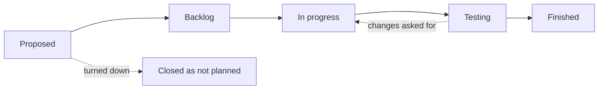
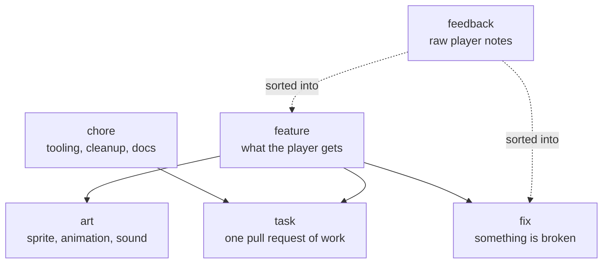

# How work moves

**The short version:** every piece of work is an issue. An issue has one type and one state. Features are parents: the tasks and art they need hang under them as sub-issues.

## The states

A card moves from left to right on the [project board](https://github.com/users/Liam-M-Mays/projects/5).

| State | Means | Moves on when |
| --- | --- | --- |
| **Proposed** | An idea, a request or player feedback. Nobody has agreed to do it yet | The team says yes, and the questions that block a start are answered |
| **Backlog** | Agreed and clear enough to start. Nobody is on it yet | Someone assigns themselves and makes a branch |
| **In progress** | Someone is working on a branch | A pull request is opened |
| **Testing** | A pull request is waiting for review and a play test | It is merged |
| **Finished** | Merged into `core-rewrite` and the issue closed by hand, or closed | |

- **Every `feature` starts as a suggestion.** It stays in Proposed until the team has talked it through. The text in a Proposed feature is a starting point for that talk, not a decision.
- **A `fix` skips Proposed and starts in Backlog.** Something broken gets fixed, so there is nothing to agree on. If nobody can repeat the bug yet, the first job is to find the steps.
- An idea the team turns down is closed as "not planned". It stays searchable.
- The state lives on the board only. There is no "proposed" label, so the two can never disagree.
- The board moves a card to Finished by itself when its issue is closed.
- **During the core rewrite** every pull request goes into the branch `core-rewrite`, not into `master`. GitHub does not close an issue from that branch, so the issue is closed by hand after its last pull request is merged. The plan is issue #57.

## The types

Every issue has exactly one type. The type is a label, and the issue form sets it.

| Type | What it is | Parent or child |
| --- | --- | --- |
| `feature` | Something new the game should have or do, described the way a player sees it | Parent |
| `chore` | Tooling, cleanup, refactoring or docs. Players see no change | Parent, or stands alone |
| `task` | One piece of code or scene work. Small enough for one pull request | Child |
| `art` | A sprite, animation, UI piece or sound | Child, or stands alone |
| `fix` | Something is broken | Stands alone, or child of the feature it belongs to |
| `feedback` | Raw notes from players | Neither, see [Player feedback](#player-feedback) |

### Parents and children

- GitHub calls these **sub-issues**. Open the parent and press **Create sub-issue**, or choose **Add existing issue**.
- An issue has one parent at most.
- The parent says what and why. The children say how. A parent is finished when all its children are.
- A pull request names a child ("Part of #31"), not the parent. The child is closed by hand after the merge.
- **No tasks for a Proposed feature.** While a feature is only a suggestion it stays one issue. Split it into tasks and art when it moves to Backlog, once the team has agreed on what it means. That keeps the board from filling up with tasks for things we may never build.
- When one issue cannot start before another is done, mark it **blocked by** the other (issue sidebar, **Relationships**).

### Branch names

`feature/...`, `fix/...`, `art/...` or `chore/...`. A `task` uses the prefix of its parent.

## Player feedback

1. Paste the raw notes into a `feedback` issue. One issue per playtest round. Later notes go in a comment.
2. Sort every point: link it to an issue that already covers it, or open a new one. New ones start in Proposed.
3. Write the result as a table at the top of the feedback issue, so no point gets lost.
4. Close the feedback issue when the round is over and every point is sorted.

Feedback issues are a log, not work, so they stay off the board.

## The board

- **Board**: every card by state.
- **Top level**: the same, without sub-issues. Use it to see features without their tasks.
- **Fixes and chores**: only `fix`, `chore` and `task` cards.
- **Table**: everything in rows. Group it by **Parent issue** to see each feature with its children.

## Diagrams

Diagrams are written as [Mermaid](https://mermaid.js.org/) text inside Markdown files, like the two above. GitHub draws them, a change shows up in the diff, and nobody needs an account anywhere. The code diagrams are in [architecture.md](architecture.md).
